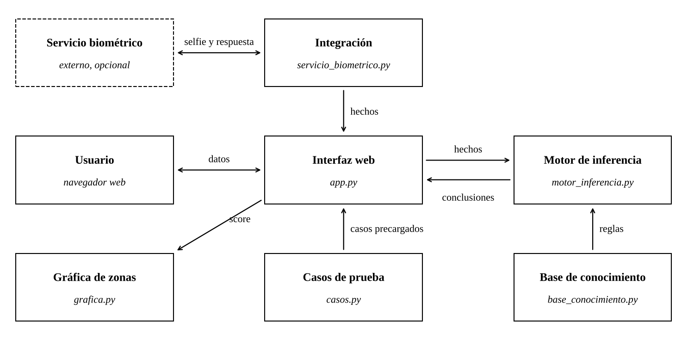

**Sistema experto de validación de identidad facial**

Documentación técnica del proyecto final

Brandon Felipe Linares Viasus

Fundación Universitaria Los Libertadores

Inteligencia Artificial II

Docente: Gonzalo Ricardo Novoa Fernández

Noviembre de 2026

# Introducción

## Descripción del dominio

Cuando una persona abre un producto financiero o hace un trámite por internet, es común que le pidan una selfie para confirmar que es quien dice ser. Un motor biométrico compara esa selfie con una foto de referencia, por lo general la del documento de identidad, y devuelve un score de similitud entre 0 y 100. Con ese número y con otras señales de la captura, alguien tiene que decidir si la validación se aprueba, si pasa a revisión manual o si se rechaza.

Este proyecto toma esa decisión con un sistema basado en conocimiento. Solo trabaja la validación facial, sin huellas ni consulta de documentos.

## Justificación y relevancia

La decisión parece sencilla, pero un umbral único no la resuelve bien. Un score de 90 no debería aprobarse si la persona puso una foto impresa frente a la cámara, que es el tipo de ataque de presentación que describe la norma ISO/IEC 30107-3 (International Organization for Standardization, 2017). Del mismo modo, un score de 72 no alcanza para aprobar, pero puede bastar si la persona ya se había enrolado antes y su selfie coincide con esa imagen. Esas excepciones forman parte del criterio de quien revisa validaciones y se pueden escribir como reglas de producción, que es la forma de representar conocimiento propia de los sistemas expertos (Giarratano y Riley, 2005).

El score tampoco es la única evidencia disponible. Una entidad suele tener una lista de riesgo propia con los fraudes que ya confirmó, puede buscar el rostro en su base facial para ver si ya está registrado con otro documento, y a veces conserva la imagen de un enrolamiento anterior de la misma persona. Combinar esas fuentes es razonamiento con varias evidencias, algo que se expresa bien con reglas.

También es un dominio donde cada decisión debe poder explicarse. Si se rechaza a una persona, hay que poder decir qué regla se aplicó y con qué datos, y eso es justo lo que aportan las funciones de explicación del motor.

## Alcance del sistema

El sistema recibe doce datos de una captura facial que el usuario ingresa en un formulario web. Con ellos entrega una decisión principal, que puede ser aprobado, zona gris, rechazado, captura inválida o sin conclusión, junto con las conclusiones adicionales, su nivel de certeza y la explicación de cómo llegó a ellas.

Los umbrales son de ejemplo: 85 para aprobar y 60 para el inicio de la zona gris, y no corresponden a la configuración de ninguna entidad real. El sistema tampoco procesa imágenes, recibe el score y las señales ya calculadas por otro componente.

# Diseño del sistema

## Arquitectura general

La aplicación tiene tres partes principales: la interfaz web, el motor de inferencia y la base de conocimiento. La Figura 1 muestra cómo se comunican.

Figura 1

Arquitectura del sistema experto

<em>Nota.</em> Elaboración propia.

## Componentes principales

La base de conocimiento está separada del motor. El motor no sabe nada de validación facial, solo recorre reglas, de modo que agregar una regla o cambiar el dominio no obliga a modificarlo. La Tabla 1 resume qué hace cada archivo.

Tabla 1

Archivos del proyecto y su responsabilidad

| Archivo | Responsabilidad |
|---|---|
| src/base_conocimiento.py | Predicados, umbrales, las 15 reglas y los textos de cada conclusión |
| src/motor_inferencia.py | Encadenamiento hacia adelante, explicación, función porque() y validación de entradas |
| src/app.py | Interfaz web: formulario, resultados, explicación y casos precargados |
| src/grafica.py | Gráfica de zonas de decisión con el score marcado |
| src/casos.py | Los 13 casos de prueba, compartidos por la interfaz y las pruebas |
| src/servicio_biometrico.py | Integración opcional con un servicio biométrico externo |
| tests/test_casos.py y tests/test_servicio.py | Pruebas automáticas con pytest |

## Flujo de datos

El usuario llena el formulario o carga un caso de prueba. La interfaz arma un diccionario con los hechos y llama a validar_hechos(); si encuentra un dato fuera de rango, muestra el error y no sigue. Si todo está bien, llama a encadenamiento_adelante() con las reglas y los hechos. El motor devuelve los hechos finales y la lista de reglas aplicadas en el orden en que se dispararon. Si los datos vienen de una selfie, el módulo de integración los obtiene del servicio externo y llena el formulario antes de este paso. Después, obtener_conclusiones() ordena las conclusiones por prioridad, la primera se muestra como decisión principal y, debajo, aparecen la gráfica, la tabla de reglas y el botón ¿Por qué?.

# Base de conocimiento

## Predicados

Todos los predicados tienen como dominio p ∈ Personas, la persona que se está validando. La Tabla 2 presenta los doce predicados de entrada.

Tabla 2

Predicados del dominio

| Predicado | Tipo | Rango | Significado |
|---|---|---|---|
| rostro_detectado(p) | Booleano | {V, F} | Se encontró un rostro en la captura |
| calidad_imagen(p, q) | Categórico | q ∈ {buena, media, baja} | Luz, enfoque y nitidez de la captura |
| uso_accesorios(p) | Booleano | {V, F} | Gafas oscuras, tapabocas o gorra |
| prueba_vida_superada(p) | Booleano | {V, F} | Hay una persona real frente a la cámara |
| sospecha_suplantacion(p) | Booleano | {V, F} | Foto impresa, pantalla o máscara |
| en_lista_riesgo(p) | Booleano | {V, F} | La identidad o el rostro tiene un fraude confirmado antes |
| rostro_en_otra_identidad(p) | Booleano | {V, F} | La búsqueda en la base facial lo encontró con otro documento |
| score_disponible(p) | Booleano | {V, F} | El motor biométrico devolvió score |
| score_facial(p, s) | Numérico | s ∈ [0, 100] | Similitud entre la selfie y la foto del documento |
| tiene_enrolamiento_previo(p) | Booleano | {V, F} | Existe una imagen de un enrolamiento anterior |
| score_enrolamiento_previo(p, e) | Numérico | e ∈ [0, 100] | Similitud entre la selfie y la imagen del enrolamiento anterior |
| intentos(p, n) | Entero | n ∈ {1, …, 5} | Intentos de validación en el día |

Además de estos datos de entrada, el motor deriva doce hechos durante el razonamiento: captura_invalida, posible_fraude, captura_valida, score_alto, score_zona_gris, score_bajo, coincide_enrolamiento, aprobado, revision_manual, rechazo_no_coincide, rechazo_fraude y bloqueo_temporal.

## Reglas en lógica de predicados

Las reglas se organizan en tres niveles que siguen el orden en que razona quien revisa una validación: primero mira si la foto sirve y si hay señales de fraude, después clasifica el score y al final decide.

El primer nivel revisa la captura y busca fraude:

R1: ∀p ¬rostro_detectado(p) ∨ calidad_imagen(p, baja) ∨ uso_accesorios(p) → captura_invalida(p)

R2: ∀p sospecha_suplantacion(p) ∨ en_lista_riesgo(p) ∨ rostro_en_otra_identidad(p) → posible_fraude(p)

R3: ∀p rostro_detectado(p) ∧ ¬prueba_vida_superada(p) → posible_fraude(p)

El segundo nivel valida la captura y compara el rostro, contra el documento y contra el enrolamiento anterior:

R4: ∀p rostro_detectado(p) ∧ ¬captura_invalida(p) ∧ score_disponible(p) → captura_valida(p)

R5: ∀p ∀s captura_valida(p) ∧ score_facial(p, s) ∧ s ≥ 85 → score_alto(p)

R6: ∀p ∀s captura_valida(p) ∧ score_facial(p, s) ∧ 60 ≤ s < 85 → score_zona_gris(p)

R7: ∀p ∀s captura_valida(p) ∧ score_facial(p, s) ∧ s < 60 → score_bajo(p)

R8: ∀p ∀e captura_valida(p) ∧ tiene_enrolamiento_previo(p) ∧ score_enrolamiento_previo(p, e) ∧ e ≥ 85 → coincide_enrolamiento(p)

R9: ∀p ∀e captura_valida(p) ∧ tiene_enrolamiento_previo(p) ∧ score_enrolamiento_previo(p, e) ∧ e < 60 → posible_fraude(p)

El tercer nivel toma la decisión:

R10: ∀p score_alto(p) ∧ ¬posible_fraude(p) → aprobado(p)

R11: ∀p score_zona_gris(p) ∧ coincide_enrolamiento(p) ∧ ¬posible_fraude(p) → aprobado(p)

R12: ∀p score_zona_gris(p) ∧ ¬coincide_enrolamiento(p) ∧ ¬posible_fraude(p) → revision_manual(p)

R13: ∀p score_bajo(p) → rechazo_no_coincide(p)

R14: ∀p posible_fraude(p) → rechazo_fraude(p)

R15: ∀p ∀n intentos(p, n) ∧ n ≥ 3 ∧ (captura_invalida(p) ∨ rechazo_no_coincide(p) ∨ rechazo_fraude(p)) → bloqueo_temporal(p)

## Reglas en formato SI-ENTONCES y su justificación

La Tabla 3 traduce cada regla al formato SI-ENTONCES, con su factor de certeza y la razón por la que existe. Los factores siguen la idea de Shortliffe y Buchanan (1975): un número entre 0 y 1 que expresa qué tan confiable es la conclusión de la regla.

Tabla 3

Reglas de producción con factor de certeza y justificación

| Regla | SI | ENTONCES | FC | Justificación |
|---|---|---|---|---|
| R1 | no hay rostro, o la calidad es baja, o usa gafas oscuras, tapabocas o gorra | captura inválida | 0.95 | Sin un rostro claro y descubierto no hay nada confiable que comparar |
| R2 | hay sospecha de suplantación, o está en la lista de riesgo, o su rostro aparece con otro documento | posible fraude | 0.95 | Cualquiera de las tres es una alerta conocida de fraude |
| R3 | hay rostro y no superó la prueba de vida | posible fraude | 0.90 | Hay una cara, pero no se confirmó que sea una persona viva |
| R4 | hay rostro, la captura no es inválida y hay score | captura válida | 1.00 | Solo se compara el rostro si la captura sirve |
| R5 | captura válida y score ≥ 85 | score alto | 0.98 | Umbral de aprobación automática |
| R6 | captura válida y 60 ≤ score < 85 | zona gris | 0.90 | Rango en el que el motor no está seguro |
| R7 | captura válida y score < 60 | score bajo | 0.95 | Por debajo de este valor es improbable que sea la misma persona |
| R8 | captura válida, hay enrolamiento anterior y su score ≥ 85 | coincide con el enrolamiento | 0.95 | La persona ya se había validado antes y es la misma |
| R9 | captura válida, hay enrolamiento anterior y su score < 60 | posible fraude | 0.90 | Coincide con el documento pero no con quien se enroló antes con esa identidad |
| R10 | score alto y no hay posible fraude | aprobado | 0.97 | Coincide y no hay señales de ataque |
| R11 | zona gris, coincide con el enrolamiento y no hay posible fraude | aprobado | 0.90 | El enrolamiento anterior es la segunda evidencia que resuelve la duda |
| R12 | zona gris, no coincide con el enrolamiento y no hay posible fraude | revisión manual | 0.90 | Sin otra evidencia, los casos dudosos los decide una persona |
| R13 | score bajo | rechazo, no coincide | 0.95 | La selfie no corresponde a la foto del documento |
| R14 | posible fraude | rechazo por fraude | 0.95 | El fraude tiene prioridad sobre cualquier score |
| R15 | 3 o más intentos y captura inválida o rechazo | bloqueo temporal | 1.00 | Evita que alguien pruebe muchas veces hasta pasar |

<em>Nota.</em> FC = factor de certeza.

# Motor de inferencia

## Algoritmo de encadenamiento hacia adelante

El motor parte de los hechos que ingresó el usuario y aplica reglas hasta que ya no puede derivar nada nuevo (Russell y Norvig, 2021). Primero agrupa las reglas por nivel. Dentro de cada nivel recorre todas las reglas, y si una no se ha disparado y todas sus condiciones se cumplen, agrega su conclusión a los hechos y la registra en la lista de reglas aplicadas. Repite ese recorrido mientras alguna regla se haya disparado en la vuelta anterior; cuando una vuelta completa no agrega nada, el nivel terminó y pasa al siguiente.

Los niveles existen por las negaciones. R4 pregunta si no hay captura inválida y R10 si no hay posible fraude. Si R4 se evaluara antes que R1, concluiría que la captura es válida y después R1 diría lo contrario. Al terminar todo el nivel 1 antes de empezar el 2, cualquier negación ya ve todo lo que se podía derivar antes. Esta forma de ordenar las reglas se conoce como estratificación.

Para las negaciones el motor trabaja con el supuesto de mundo cerrado: si un hecho no está en la base de hechos, se toma como falso. Por eso ¬posible_fraude(p) se cumple cuando ninguna regla concluyó posible_fraude.

La certeza de cada conclusión es la certeza de la regla multiplicada por la menor certeza de los hechos que usó, y los datos del usuario valen 1. Si dos reglas llegan a lo mismo, se conserva la certeza más alta. En el caso de zona gris sin enrolamiento, por ejemplo, R6 da 0.90 y R12 da 0.90 × 0.90 = 0.81.

## Mecanismo de explicación

La función explicar_razonamiento() devuelve una línea por cada regla aplicada, en el orden en que se disparó, con sus condiciones, su conclusión y su certeza. La función porque() arma la explicación al revés: busca la regla que concluyó el hecho que el usuario eligió, muestra sus premisas y repite lo mismo con cada premisa hasta llegar a los datos ingresados. Las premisas negadas aparecen como "se toma como falso (mundo cerrado)".

## Manejo de casos especiales

Si ninguna regla se dispara, la lista de reglas aplicadas queda vacía y tanto el motor como la interfaz lo informan con un mensaje, en lugar de inventar una decisión. Para evitar ciclos infinitos, cada regla se dispara una sola vez y cada nivel tiene un tope de 100 iteraciones; si se supera, el motor lanza el error CicloInfinitoError. Una de las pruebas usa dos reglas que se alimentan entre sí y comprueba que el motor termina.

Si una regla intenta cambiar el valor de un hecho que ya existe, el cambio se ignora y queda en el registro, así ningún hecho cambia de valor a mitad del razonamiento. Los datos fuera de rango se rechazan antes de llegar al motor, y cada regla disparada se registra con el módulo logging de Python, con su nivel, iteración, conclusión y certeza.

# Implementación técnica

## Tecnologías utilizadas

El proyecto está escrito en Python 3.10. El motor y la base de conocimiento solo usan la biblioteca estándar. La interfaz se hizo con Streamlit (Streamlit Inc., s. f.), la gráfica con Matplotlib, la conexión con el servicio biométrico con requests y las pruebas con pytest.

## Decisiones de diseño importantes

Se eligió Streamlit en lugar de Flask porque permite hacer el formulario, los resultados y la gráfica solo con Python, sin escribir HTML ni JavaScript, y eso facilita modificar la interfaz en vivo.

Las reglas son diccionarios dentro de una lista. Agregar una regla consiste en copiar un diccionario, sin tocar el motor. Cada condición es una tupla de la forma (hecho, operador, valor), lo que permite comparaciones numéricas como score ≥ 85 además de hechos booleanos. Para las disyunciones se agregó una condición especial llamada "cualquiera", que usan R1, R2 y R15.

Cuando salen varias conclusiones, la que tiene menor número de prioridad es la decisión principal. El fraude tiene prioridad 1, así que nunca queda escondido detrás de un score alto.

El formulario está dividido en cuatro grupos que siguen el orden del razonamiento: calidad de la captura, prueba de vida y fraude, comparación del rostro e historial de intentos. La gráfica de zonas marca el score contra el documento y, si existe, el score contra el enrolamiento anterior. Cada campo tiene un texto de ayuda que dice qué regla lo usa.

La gráfica de zonas usa naranja para el rechazo, gris para la zona gris y azul para la aprobación, una combinación pensada para personas con daltonismo (Okabe e Ito, 2008). Cada zona lleva además su nombre escrito.

La interfaz y las pruebas usan el mismo archivo de casos, de modo que lo que se muestra en la demostración es lo mismo que se prueba.

## Integración opcional con un servicio biométrico externo

Además del formulario manual, la aplicación puede recibir una selfie, tomada con la cámara o cargada como archivo, y enviarla a un servicio biométrico externo. El proceso tiene dos pasos. En el primero se consulta a la persona por su documento, y el servicio responde si ya tiene un rostro registrado. Si no lo tiene, es un enrolamiento: la selfie del segundo paso se guarda como su rostro de referencia. Si ya lo tiene, es una validación: la selfie se compara contra el rostro guardado y el servicio devuelve el score, la detección de suplantación y una alerta de riesgo sobre el rostro. La interfaz muestra en cuál de los dos casos está la persona antes de enviar la selfie. El sistema no almacena imágenes, porque las conserva el servicio.

La respuesta se traduce a hechos del dominio en el módulo servicio_biometrico.py. El score pasa a score_facial, la suplantación a sospecha_suplantacion y prueba_vida_superada, y la alerta de riesgo a en_lista_riesgo. Los errores de "no es una persona real" y "no es un rostro" también se convierten en hechos, de modo que los decide el sistema experto con sus reglas y no la interfaz. Con esos hechos se llena el formulario y se ejecuta el mismo motor de inferencia, sin cambiar ninguna regla.

Las direcciones del servicio y las credenciales no están en el código. Se leen de un archivo de secretos que no se sube al repositorio, y en la versión publicada la sección puede protegerse con una clave. Si el servicio no está configurado o no responde, el formulario manual y los casos de prueba siguen funcionando. El flujo se prueba sin red con respuestas simuladas en tests/test_servicio.py.

## Desafíos encontrados y soluciones

El primer desafío fue el orden de las reglas con negación. Con todas las reglas en un solo grupo, R4 podía dispararse antes que R1 y la captura quedaba válida e inválida al mismo tiempo; se resolvió con los tres niveles.

El segundo fue el límite de quince reglas. Al incorporar la lista de riesgo, la base facial y el enrolamiento anterior, el sistema pasaba de ese número. Se resolvió agrupando con disyunción las causas que llevan a la misma conclusión: las tres causas de captura inválida quedaron en R1 y las tres alertas de fraude en R2. La explicación no pierde detalle, porque el motor solo muestra la opción que se cumplió.

El tercero fue el estado de la interfaz. Streamlit vuelve a ejecutar todo el programa con cada clic, así que el resultado se guarda en st.session_state para que no se pierda al presionar ¿Por qué?.

# Validación

## Tabla de casos de prueba

La Tabla 4 resume los trece casos de prueba. El detalle está en tests/casos_prueba.md, y los trece casos, junto con las demás pruebas, 30 en total, pasan al ejecutar python -m pytest tests.

Tabla 4

Casos de prueba y resultados

| Caso | Hechos iniciales | Reglas esperadas | Conclusión esperada | Resultado obtenido | Estado |
|---|---|---|---|---|---|
| 1 | Score 92, calidad buena, prueba de vida superada | R4, R5, R10 | Aprobado | Aprobado | ✓ |
| 2 | Score 72, sin enrolamiento anterior | R4, R6, R12 | Revisión manual | Revisión manual | ✓ |
| 3 | Score 72, enrolamiento anterior 91 | R4, R6, R8, R11 | Aprobado | Aprobado | ✓ |
| 4 | Score 40 | R4, R7, R13 | Rechazo, no coincide | Rechazo, no coincide | ✓ |
| 5 | Score 90, suplantación, sin prueba de vida, 3 intentos | R2, R3, R4, R5, R14, R15 | Rechazo por fraude | Rechazo por fraude y bloqueo | ✓ |
| 6 | Score 95, en lista de riesgo | R2, R4, R5, R14 | Rechazo por fraude | Rechazo por fraude | ✓ |
| 7 | Score 91, enrolamiento anterior 45 | R4, R5, R9, R14 | Rechazo por fraude | Rechazo por fraude | ✓ |
| 8 | Sin score, calidad media | Ninguna | Sin conclusión | Sin conclusión | ✓ |
| 9 | Score 85 | R4, R5, R10 | Aprobado | Aprobado | ✓ |
| 10 | Score 60 | R4, R6, R12 | Revisión manual | Revisión manual | ✓ |
| 11 | Score 88, calidad baja, accesorios, 4 intentos | R1, R15 | Captura inválida | Captura inválida y bloqueo | ✓ |
| 12 | Sin rostro | R1 | Captura inválida | Captura inválida | ✓ |
| 13 | Score 40, enrolamiento 30, suplantación, otra identidad, sin prueba de vida, 3 intentos | R2, R3, R4, R7, R9, R13, R14, R15 | Rechazo por fraude | Rechazo por fraude, rechazo por no coincidir y bloqueo | ✓ |

## Análisis de resultados

Los trece casos dan la conclusión esperada y aplican exactamente las reglas previstas, en el orden previsto, y entre todos usan las quince reglas. El caso 13 activa ocho de las quince, la mayoría. El caso 5 confirma la regla más importante del dominio: con un score de 90 el sistema rechaza por fraude, porque R10 exige que no haya posible fraude. Los casos 6 y 7 muestran que la lista de riesgo y el enrolamiento anterior también anulan un score alto, y el caso 3 que el enrolamiento resuelve la zona gris sin revisión manual. Los casos 9 y 10 prueban los bordes de las zonas, ya que 85 entra en aprobación y 60 en zona gris, y el caso 8 confirma que, sin score, el sistema no inventa una decisión.

## Limitaciones identificadas

Ningún caso puede activar las quince reglas a la vez, porque varias ramas se excluyen entre sí: un score no puede ser alto y bajo al mismo tiempo, y una captura inválida impide comparar el rostro.

Los umbrales y los factores de certeza son de ejemplo; en un sistema real se ajustarían con datos históricos de validaciones. El sistema tampoco procesa imágenes ni consulta la lista de riesgo o la base facial; depende de que otros componentes entreguen esos resultados. Por último, R15 no distingue si los intentos fallidos fueron por la misma causa.

# Conclusiones

## Logros alcanzados

Se construyó un sistema experto que funciona de punta a punta, con 12 predicados, 15 reglas en tres niveles y factores de certeza, que combina el score contra el documento con la lista de riesgo, la base facial y el enrolamiento anterior. El motor de encadenamiento hacia adelante es independiente del dominio e incluye explicación, la función porque(), control de ciclos y registro del proceso. La interfaz web permite cargar casos precargados y muestra en una gráfica la zona en la que cayó el score. Los trece casos de prueba se ejecutan de forma automática y pasan sin errores.

## Aprendizajes obtenidos

Las negaciones complican el encadenamiento hacia adelante; sin ordenar las reglas por niveles, el resultado depende del orden en que estén escritas. También resultó útil revisar qué reglas activaba cada caso, porque así se detectaron reglas sin probar y se agregaron casos para cubrirlas. Por último, agrupar causas con disyunción permitió sumar nuevas fuentes de evidencia sin pasar del número de reglas. Separar la base de conocimiento del motor hizo que modificar el sistema fuera rápido.

## Posibles mejoras futuras

Los umbrales podrían leerse desde un archivo de configuración para ajustarlos sin tocar el código. También se podría agregar la validación por huella como otra fuente de evidencia, y guardar un historial de validaciones para que R15 cuente los intentos reales en lugar de un dato ingresado.

# Referencias

Giarratano, J. C. y Riley, G. D. (2005). *Expert systems: Principles and programming* (4.ª ed.). Thomson Course Technology.

International Organization for Standardization. (2017). *Information technology — Biometric presentation attack detection — Part 3: Testing and reporting* (ISO/IEC 30107-3:2017).

Okabe, M. e Ito, K. (2008). *Color universal design (CUD): How to make figures and presentations that are friendly to colorblind people*. https://jfly.uni-koeln.de/color/

Russell, S. y Norvig, P. (2021). *Artificial intelligence: A modern approach* (4.ª ed.). Pearson.

Shortliffe, E. H. y Buchanan, B. G. (1975). A model of inexact reasoning in medicine. *Mathematical Biosciences, 23*(3-4), 351-379.

Streamlit Inc. (s. f.). *Streamlit documentation*. https://docs.streamlit.io

