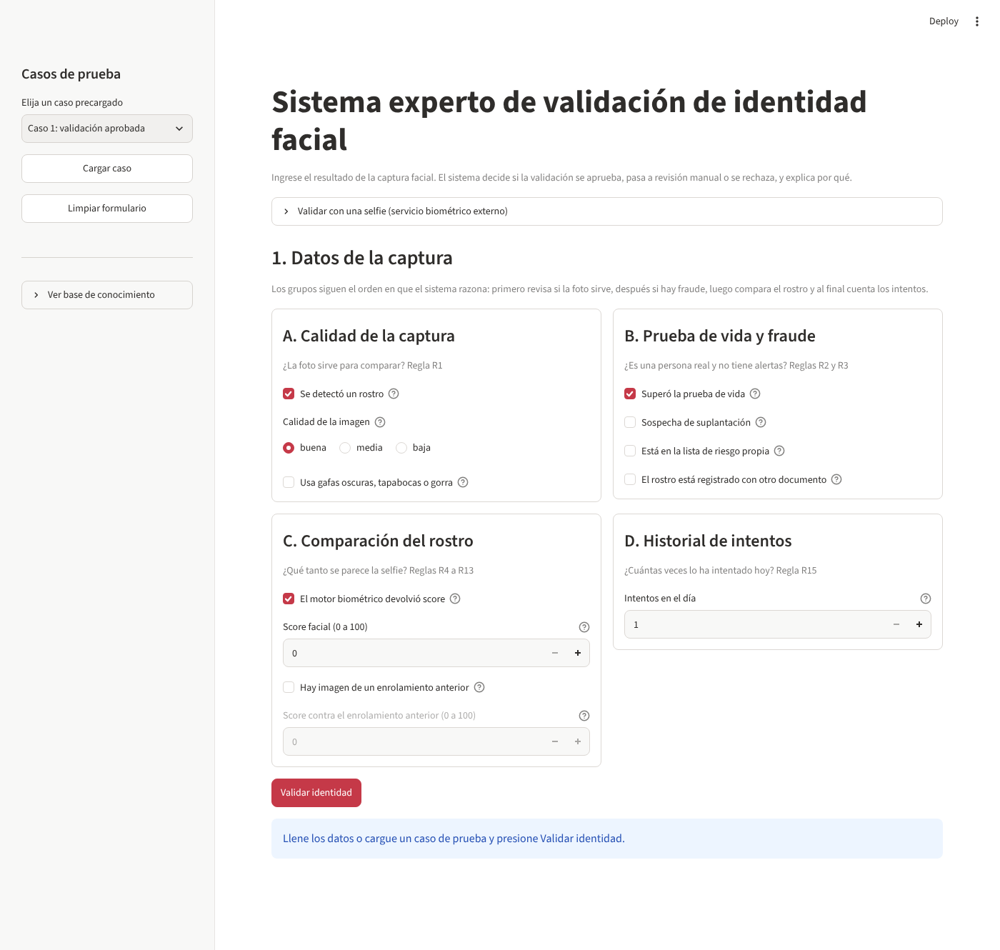
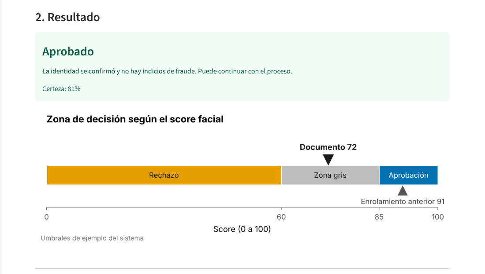
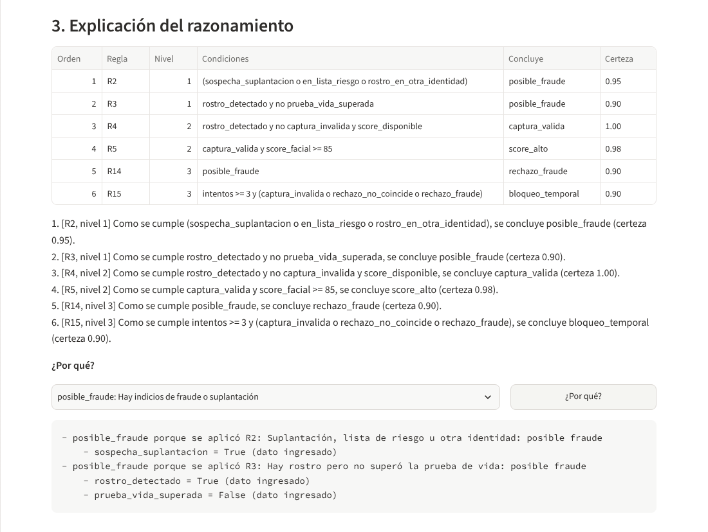

<div class="titulo">

**Sistema experto de validación de identidad facial**

Manual de usuario

Brandon Felipe Linares Viasus

Fundación Universitaria Los Libertadores · Inteligencia Artificial II · Noviembre de 2026

</div>

# Instalación

## Versión en línea

La aplicación está publicada en https://linaressbc-b4psbrerwigawdyyl2viqu.streamlit.app y se abre desde cualquier navegador, sin instalar nada.

## Ejecución local

Se necesita Python 3.10 o superior; el sistema se probó con la versión 3.14. Se descarga el proyecto con git clone https://github.com/blinaresv/Linares_SBC.git o se descomprime el ZIP, y desde esa carpeta se ejecuta lo siguiente. En Windows se usa python en lugar de python3 y venv\Scripts\activate para activar el entorno.

```
python3 -m venv venv
source venv/bin/activate
pip install -r requirements.txt
streamlit run src/app.py
```

La aplicación se abre en http://localhost:8501 y se cierra con Ctrl + C en la terminal. Las siguientes veces basta con activar el entorno y ejecutar la última línea. Las pruebas automáticas se corren con python3 -m pytest tests.

# Uso de la interfaz

## Pantalla inicial

La Figura 1 muestra la pantalla: a la izquierda la barra lateral y a la derecha el formulario.

<p class="fignum">Figura 1</p>
<p class="figtit">Pantalla inicial de la aplicación</p>

{.media}

En la barra lateral se elige uno de los trece casos de prueba y se presiona Cargar caso para llenar el formulario con sus datos. El botón Limpiar formulario vuelve a los valores iniciales y borra el resultado, y la opción Ver base de conocimiento muestra las 15 reglas.

El formulario está dividido en cuatro grupos, en el mismo orden en que razona el sistema. El grupo A, calidad de la captura, pregunta si la foto sirve: si se detectó un rostro, cómo es la calidad de la imagen y si la persona usa gafas oscuras, tapabocas o gorra. El grupo B, prueba de vida y fraude, pregunta si hay una persona real y si tiene alertas: si superó la prueba de vida, si hay sospecha de suplantación, si está en la lista de riesgo propia y si su rostro aparece registrado con otro documento en la base facial.

El grupo C, comparación del rostro, recibe el score facial contra la foto de referencia, de 0 a 100. Si la persona ya se había enrolado antes, se marca la casilla del enrolamiento anterior y se escribe el score contra esa imagen. Los campos de score se desactivan cuando se desmarca su casilla. El grupo D registra los intentos del día, de 1 a 5. El ícono de interrogación junto a cada campo explica qué regla usa ese dato.

Al terminar se presiona Validar identidad. Si algún dato está fuera de rango, aparece un mensaje que explica qué corregir.

## Ejemplo de uso: zona gris resuelta con el enrolamiento anterior

Se carga el Caso 3 y se presiona Validar identidad. El resultado aparece en tres secciones. La primera muestra la decisión principal en un recuadro, con su certeza, y debajo las conclusiones adicionales si las hay. La segunda es la gráfica de zonas: el triángulo negro de arriba marca el score contra el documento y el triángulo gris de abajo el score contra el enrolamiento anterior. La tercera es la explicación, con la tabla de reglas aplicadas en orden. En este caso el score de 72 cae en zona gris, pero la selfie coincide con la imagen del enrolamiento anterior, así que la validación se aprueba sin pasar a revisión manual. Con el Caso 2, que tiene el mismo score y no tiene enrolamiento anterior, la validación va a revisión manual.

<p class="fignum">Figura 2</p>
<p class="figtit">Resultado de un caso en zona gris con enrolamiento anterior</p>

{.media}

## Ejemplo de uso: botón ¿Por qué?

Se carga el Caso 5, se presiona Validar identidad y se baja hasta la sección ¿Por qué?. Allí se elige una conclusión de la lista y se presiona el botón. El sistema muestra la cadena de reglas que llevó a esa conclusión, desde la regla final hasta los datos ingresados. En la Figura 3, posible_fraude salió por dos caminos: R2, por la sospecha de suplantación, y R3, porque la persona no superó la prueba de vida.

<p class="fignum">Figura 3</p>
<p class="figtit">Explicación del razonamiento y botón ¿Por qué?</p>

{.media}

Si se carga el Caso 8, que no tiene score, ninguna regla se puede aplicar y el sistema lo informa con un mensaje en lugar de dar una decisión.

## Validar con una selfie

Si el servicio biométrico está configurado, se usa la sección Validar con una selfie, arriba del formulario. En el paso 1 se escribe el documento y se presiona Consultar: la app indica si la persona no tiene rostro registrado, que es un enrolamiento, o si ya lo tiene, que es una validación. En el paso 2 se toma o carga la selfie. En un enrolamiento, el botón Guardar rostro la registra; en una validación, Comparar rostro la compara contra el rostro guardado, llena el formulario y muestra el resultado.

# Interpretación de resultados

## Cómo leer las conclusiones

La decisión principal es la que aparece primero y en el recuadro más grande. La Tabla 1 explica cada posible resultado.

<p class="tabnum">Tabla 1</p>
<p class="tabtit">Significado de cada resultado</p>

| Resultado | Qué significa |
|---|---|
| Aprobado | El rostro coincide y no hay señales de fraude |
| Zona gris: revisión manual | El score no alcanza para aprobar ni es tan bajo como para rechazar, y no hay enrolamiento anterior que lo confirme |
| Rechazado por posible fraude | Hay suplantación, lista de riesgo, rostro con otro documento o diferencia con el enrolamiento anterior; se rechaza aunque el score sea alto |
| Rechazado: el rostro no coincide | El score está por debajo de 60 |
| Captura inválida | La captura no sirve para comparar |
| Bloqueo temporal | La persona lleva 3 o más intentos fallidos en el día |

La certeza va de 0 % a 100 % e indica qué tan confiable es la conclusión según las reglas que se usaron. Cuantas más reglas se encadenan para llegar a una conclusión, más baja suele ser su certeza. Las zonas del score son de 85 a 100 para aprobación, de 60 a 84 para zona gris y de 0 a 59 para rechazo; son umbrales de ejemplo y se cambian en src/base_conocimiento.py.

## Qué hacer con las recomendaciones

Si se aprueba, el proceso continúa; en zona gris, un revisor compara la selfie con la foto de referencia y decide. Un rechazo por fraude se reporta al área de seguridad, y si el rostro no coincide se pide otro medio de validación. Ante una captura inválida se pide una nueva con buena luz, de frente y sin accesorios; ante un bloqueo no se permiten intentos durante 24 horas, y sin conclusión se revisa que haya score y se repite la validación.
